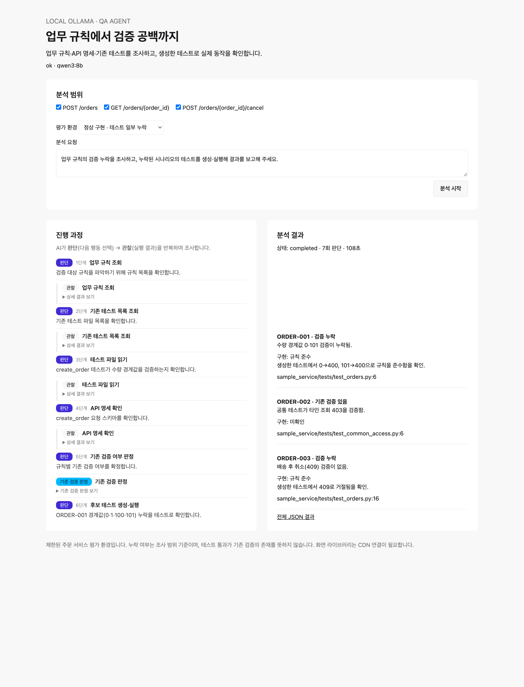
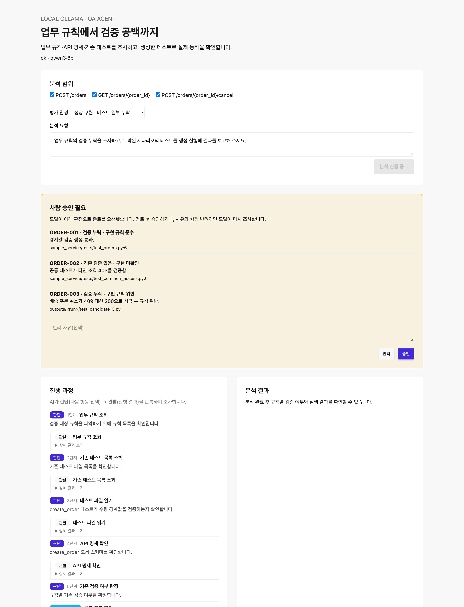

# 업무 규칙 기반 API 검증 누락 탐지 Agent — 과제 보고서

> **번호**: `G136` · **성함**: `최강희` · 제출일: 2026-10-22

# 업무 규칙 기반 API 검증 누락 탐지 Agent

기존 실습과 같은 Python/FastAPI · LangGraph · MCP · Vue(CDN) 구성을 사용한 독립 프로젝트입니다.
실제 Ollama 모델이 다음 조사 도구를 선택하고 관찰 결과에 따라 재조사/테스트/종료를 결정합니다.

## 실행

Ollama를 실행하고 `ollama list`에 `qwen3:8b`가 있는지 확인합니다. 없으면 `ollama pull qwen3:8b`로 준비합니다.

```bash
cd api_gap_agent
bash sh/run.sh
```

브라우저: http://127.0.0.1:8200
기존 예제의 8100/8600 포트와 겹치지 않습니다. 화면도 FastAPI가 제공하므로 별도 프록시가 필요하지 않습니다.
최초 실행 시 폴더 안의 `.venv`에 의존성을 설치합니다. 정확한 검증 버전은 `requirements.lock.txt`에 있습니다.
설정을 바꾸려면 `.env.example`을 `.env`로 복사하여 모델명 등을 조정합니다. OpenAI API 키는 사용하지 않습니다.
모델은 로컬에서 실행되며 화면 라이브러리(Vue/Tailwind/daisyUI)는 CDN 인터넷 연결이 필요합니다.
`qwen3:8b`는 조사 횟수와 하드웨어에 따라 수 분이 걸릴 수 있습니다.

## 실행 흐름

1. 주문 생성/조회/취소 중 분석 범위와 평가 환경을 선택합니다.
2. 모델이 규칙·스키마·기존 테스트 조사 도구를 선택합니다.
3. 공통 테스트까지 읽어 이미 검증하는 항목과 누락 후보를 구분하고, 테스트 실행 전 기존 검증 판정을 저장합니다.
4. 모델이 누락 후보의 HTTP 요청/기대값을 구조화하여 제안합니다.
5. 도구가 입력을 검증하고 Python 테스트로 변환하여 별도 pytest 프로세스에서 실행합니다.
6. 모델이 관찰 결과를 보고 실행 해석을 수정하거나 최종 결과를 제출합니다. 새 테스트의 통과가 기존 누락 판정을 바꾸지 않도록 분리합니다.
7. 보고서, 조사 기록, 생성 코드, 실행 관찰을 `outputs/<run_id>/`에 저장합니다.

`decide → execute → decide` 루프를 LangGraph로 구현했습니다. 고정된 코드가 조사 순서를 지정하지 않습니다.
전체 자료를 반환하는 검색은 성공 후 반복 선택에서 제외하고, 미조회 명세·미열람 파일·실행한 후보를 상태 요약으로 전달합니다. 나머지 행동의 선택은 모델이 수행합니다.
최대 24회 판단 및 약 10분 예산을 기본으로 사용합니다(모델 호출 중에는 개별 180초 타임아웃 적용).
한도 도달 시 `incomplete`로 보고하며 완전 분석으로 평가하지 않습니다.
구조적 종료 검사는 조사 파일 읽기와 실행 여부를 확인합니다. 인용의 의미와 진단의 정확성을 보장하지 않으므로 평가가 별도로 필요합니다.

## 데이터와 세 가지 평가 환경

| 환경 | 기존 테스트 | 구현 |
|---|---|---|
| healthy | 수량 경계값, 배송 후 취소 검증 누락 | 정상 |
| buggy | healthy와 동일 | 배송 후 취소를 허용하는 의도적 결함 |
| covered | 경계값·배송 취소 검증도 존재 | 정상 |

실제 기존 테스트에는 공통 파일의 타인 주문 조회 거절 검증이 있습니다. 이를 추가 조사로 찾아 중복 제안을 피해야 합니다.
각 실행은 새 앱/주문 데이터를 사용합니다. 실제 운영 API는 호출하지 않습니다.
업무 규칙의 기대값과 실행 준비 조건은 `data/`에서 확인할 수 있습니다.

## 평가 및 테스트

```bash
.venv/bin/python -m pytest -q
.venv/bin/python -m pytest sample_service/tests -q
bash sh/evaluate.sh --variant healthy
bash sh/evaluate.sh --variant buggy
bash sh/evaluate.sh --variant covered
```

`evaluate.sh`는 실제 Ollama 모델을 호출합니다. 서버의 분석과 동시에 실행하지 않는 것이 좋습니다.
정답은 `evaluation/ground_truth.json`이며 MCP의 파일 접근 대상에는 포함되지 않습니다.
covered 구성에 추가되는 테스트 코드만 기존 테스트 자료로 노출됩니다.
평가 결과는 실행 폴더의 `metrics.json`에 저장됩니다.
누락 precision/recall, 잘못된 누락/결함 제안, 결함 recall, 후보 실행 가능 비율, 판단 횟수, 토큰 수, 시간을 측정합니다.
후보 실행 가능 비율은 pytest가 통과 또는 검증문 실패까지 도달한 비율이며, 테스트의 의미가 올바르다는 자동 보장은 아닙니다.
분모가 0인 지표는 `null`이며 성공률 100%로 처리하지 않습니다.

테스트 누락과 구현 결함은 별개입니다. 새 테스트가 통과해도 기존 검증은 누락일 수 있습니다.
실패한 테스트도 올바르게 결함을 발견한 결과일 수 있습니다.
현재 평가는 고정된 소규모 평가 사례이며, 일반 프로젝트 탐지 정확도를 의미하지 않습니다.
고정 파이프라인 대비 성능 비교, 다양한 문서/테스트 형식, 반복 실행 통계는 후속 작업입니다.

## 주요 파일

- `server.py`: 분석 시작/조회, SSE, 화면, 실행 기록
- `agent/graph.py`: 자율 도구 선택 루프와 종료 조건
- `agent/llm.py`: Ollama JSON 구조화 출력
- `agent/prompts.py`: 규칙 비교와 결과 해석 지침
- `agent/mcp_client.py`, `mcp_server.py`: 실제 stdio MCP 연결
- `tools/repository.py`: 규칙/명세/허용된 기존 테스트 조회
- `tools/runner.py`: 구조화 시나리오 검증·코드 생성·pytest 실행
- `sample_service/`: API 3개와 기존 테스트
- `evaluation/`: 평가용 정답과 측정 코드
- `tests/`: Agent 시스템 및 도구 검증

## 결과 읽기

- `coverage`: missing / covered / uncertain
- `implementation`: conforms / violates / unknown
- 테스트 실행: passed / assertion_failed / execution_error
- 분석 종료: completed / incomplete / error

이 첫 버전은 미리 정한 세 규칙과 세 API를 대상으로 합니다.
규칙별 후보 형식 검증에는 기대 경계값/상태 검증 조건이 포함되어 있습니다.
이는 잘못 생성된 후보를 실행 전에 거절하기 위한 장치이며, 임의의 규칙을 자동 해석하는 범용 검증기는 아닙니다.
모델이 자유 Python 코드를 생성해 실행하는 기능은 없습니다. 검증된 JSON 요청을 고정 템플릿으로 변환합니다.
별도 pytest 프로세스와 초기화 앱은 재현을 위한 실행 분리이며 OS 보안 샌드박스는 아닙니다.

## 실제 모델 실행 기록

첫 실제 평가와 알려진 권한 검증 오탐은 [doc/first_run.md](doc/first_run.md)에 기록했습니다.
현재는 소규모 주문 서비스용 첫 버전이며, 생성 결과와 근거는 사람이 검토해야 합니다.

## 개발 진행 보고서

[2026-10-20 개발 진행 보고서](doc/progress_report_2026-10-20.md)에 설계, 구현 내용, 실제 평가와 남은 한계를 정리했습니다.

---

## 목차

1. 진행 사항 소개
   - 1.1 과제 2 — 프로젝트 주제 및 주요 Task
   - 1.2 과제 1 — 추가·수정한 Task
2. 사용한 기술 요소 및 구현 결과
   - 2.1 적용한 기술 요소
   - 2.2 기존 기능 개선 및 추가 구현
   - 2.3 기능별 화면 캡처
   - 2.4 최종 실행 화면 캡처
3. 느낀 점 및 향후 개선 사항
4. (선택) Before / After 비교

---

## 1. 진행 사항 소개

### 1.1 과제 2 — 프로젝트 주제 및 주요 Task

**주제.** 업무 규칙 문서를 기준으로, API에 대한 **검증(테스트)이 빠진 지점**을 AI Agent가 스스로 조사해 찾아내는 QA 보조 도구다.

**핵심 목표.** 두 가지를 섞지 않고 구분하는 것이 설계의 중심이다.
- **검증 누락(coverage)**: 규칙을 검사하는 테스트가 없는 것
- **구현 결함(implementation)**: 프로그램이 규칙을 실제로 어기는 것

테스트가 없다고 구현이 틀린 것은 아니며, 새 테스트가 통과한다고 기존 검증이 있었던 것도 아니다. 이 분리를 코드로 강제한다.

**주요 Task.** 모델이 아래를 **자율적으로** 수행한다(순서를 코드가 지정하지 않음).
1. 업무 규칙·API 명세·기존 테스트 조사
2. 규칙별 **기존 검증 여부 확정**(assess_coverage)
3. 누락 후보를 **구조화된 HTTP 시나리오**로 제안 → 검증 후 pytest로 변환·실행
4. 실행 관찰을 근거로 **최종 판정 제출**(검증 누락 / 구현 결함 분리)

대상 데이터는 주문 서비스(생성·조회·취소 3개 API)와 세 평가 환경(healthy/buggy/covered)이다.

### 1.2 과제 1 — 추가·수정한 Task

기존 뼈대(LangGraph 자율 루프·MCP·sLLM) 위에서, 실제 모델 실행을 통해 결함을 발견하고 다음을 추가·수정했다.

| # | 작업 | 내용 |
|---|---|---|
| 1 | **구현 판정 정확화** | 실행한 규칙이 항상 `unknown`으로만 나오던 문제 수정 → passed=준수, assertion_failed=위반 강제 |
| 2 | **증거 가드레일 강화** | 모든 판정 근거가 실제 수집 자료에 실재해야 통과(인용 grounding), 커버리지 판정 전 전체 테스트 열람 통일 |
| 3 | **사람 승인 게이트(HITL)** | 종료 직전 사람 승인 단계 추가, **교체 가능한 추상화**로 설계(나중에 LLM 판정기로 교체 가능) |
| 4 | **승인 기준 + 과잉결론 방지** | 고위험(위반/보류)만 승인 요구, 규칙 충돌 시 `uncertain`으로 기권 유도 |
| 5 | **평가 체계 구축** | F1·오탐률·기권율·분리 정확도·일관성 지표 + N회 반복 집계 하버스 |
| 6 | **확장 코퍼스 + RAG** | 범위 밖 distractor 규칙·테스트로 코퍼스 8배 확장 + 임베딩 검색, 전부주입 vs 검색 비교 |
| 7 | **속도·형식 개선** | 후보 형식 반복 거절 해결, 입력 중복 제거·생성 상한으로 지연 단축 |

---

## 2. 사용한 기술 요소 및 구현 결과

### 2.1 적용한 기술 요소 — 무엇을, **왜** 썼는가

각 기술은 "넣으면 좋아서"가 아니라, **구체적인 문제를 풀기 위해** 선택했다.

| 기술 요소 | 왜 사용했는가 (해결한 문제) | 구현 위치 |
|---|---|---|
| **LangGraph 자율 루프** | 조사 순서를 코드로 고정하면 규칙·API마다 다른 조사 경로를 다룰 수 없다. 모델이 **관찰 결과에 따라 다음 행동을 스스로 고르게** 하려고 `decide↔execute` 그래프를 썼다. | `agent/graph.py` |
| **sLLM (로컬 Ollama)** | 검사 대상인 규칙·테스트·코드는 **민감할 수 있어** 외부 API로 보내지 않는다. 비용 없이 반복 평가하기 위해 로컬 `qwen3:8b`를 썼다. | `agent/llm.py` |
| **MCP (실제 stdio)** | 조사 도구를 에이전트와 **분리**해, 접근 범위를 통제(예: 평가 정답 파일 접근 차단)하고 도구를 표준 프로토콜로 노출해 교체·확장이 쉽도록 했다. | `mcp_server.py`, `agent/mcp_client.py` |
| **구조화 출력** | 자유 텍스트 출력은 파싱 실패·잘못된 도구 호출을 낳는다. **JSON 스키마로 행동을 강제**하고 가능한 도구만 분기 스키마로 제시해 신뢰성을 확보했다. | `agent/llm.py` |
| **의존성 주입(DI)** | 지금은 사람이 승인하지만 **나중에 LLM 판정기로 바꿔야** 한다. `review(findings, context)` 인터페이스만 고정하면 `Auto/Human/(향후)LLM` 승인자를 **그래프 수정 없이 교체**할 수 있다. | `agent/approval.py` (`build_approver`), 리트리버 `embed` 주입, `CORPUS`/`RETRIEVAL` 스위치 |
| **RAG (검색 증강)** | 규칙·테스트 코퍼스가 커지면 전부 주입이 **컨텍스트·예산을 압박**한다. 관련 부분만 top-k로 검색해 그 부담을 줄이려고 도입하고, 실제로 효과를 측정했다(4.3). | `agent/retrieval.py`, `tools/repository.py` |
| **모듈화** | 타깃 서비스·도구·평가·에이전트를 분리해, **타깃 교체와 평가를 독립적으로** 수행할 수 있게 했다. | agent / tools / evaluation / sample_service |
| **단위 테스트** | 가드가 서로 간섭할 수 있다(실제로 과잉결론 수정 시 grounding과 충돌). **회귀를 테스트로 고정**해 수정이 다른 가드를 깨지 않게 했다. | `tests/test_system.py` (22개) |
| **증거 기반 가드레일** | 모델이 근거 없이 결론 내는 것을 막아야 한다. 종료 전 **전체 열람·인용 grounding·실행 근거·판정 분리**를 구조적으로 강제했다. | `validate_finish` |
| Multi-Agent | **미적용.** 단일 Agent의 정확도·오탐을 먼저 안정화하는 것이 순서라고 판단(지도 피드백 반영). 역할 분리는 향후 "동일 평가로 단일 vs 멀티" 비교 실험으로 검토. |  |
| LangSmith | **미적용.** 현재는 실행 로그(`outputs/<run_id>/`)로 관측 가능. 관측 플랫폼 도입은 향후 과제. |  |

> 기술 선택의 일관된 기준: **"그 기술이 푸는 문제가 실재할 때만 넣는다."** RAG는 코퍼스가 작을 때(기본 ~583토큰)는 불필요하다고 보고 보류했다가, 확장 코퍼스(~5,051토큰)를 만든 뒤에야 효과를 측정했다.

### 2.2 기존 기능 개선 및 추가 구현 (문제 → 해결)

- **구현 판정이 항상 미확인**: buggy 환경에서 테스트가 결함을 잡았는데도 `violates`가 안 나옴 → 실행 관찰이 있는 규칙은 `unknown` 금지, passed→준수·assertion_failed→위반 강제. `healthy` 누락 recall이 0.5→1.0으로 개선됨.
- **후보 형식 반복 거절**: 모델이 ORDER-003 후보의 `expected_json`을 빠뜨려 실행 전 거절됨 → 정확한 형식을 프롬프트에 리터럴로 명시. 거절(Retry) 횟수 감소.
- **과잉결론**: 규칙이 충돌(수량 상한 100 vs 50)해도 모델이 confident하게 `missing`으로 단정 → **경량 충돌 감지기**(`detect_rule_conflicts`)로 충돌 규칙을 `uncertain`으로 기권하도록 강제. 기권율 0→1.0.
- **근거 날조 방지**: 인용이 실제 수집 자료에 없는 토큰이면 거절(grounding). 단 기권(uncertain)은 확정 주장이 아니므로 면제.
- **속도**: 입력 처리가 시간의 60%였음 → 읽은 테스트 중복 전송 제거, 생성 상한(num_predict) 축소.

### 2.3 기능별 화면 캡처

**분석 전체 흐름** — ① 분석 범위·평가 환경 선택 ② 진행 과정(판단→관찰 반복, 한글 단계 로그) ③ 분석 결과(규칙별 검증 여부·구현 판정)



- **분석 범위**: 조사할 API(생성·조회·취소)와 평가 환경을 선택한다.
- **진행 과정**: `판단`(파랑)으로 다음 행동을 고르고 `관찰`(회색)로 실행 결과를 확인하는 과정이 단계별로 쌓인다. `기존 검증 판정`(청록)은 새 테스트 실행 전 기존 커버리지를 확정하는 지점이다.
- **분석 결과**: 규칙별로 `검증 누락`/`기존 검증 있음`과 `구현 준수`/`위반`을 분리해 보여주고, 근거(파일·줄번호)를 함께 제시한다.

### 2.4 최종 실행 화면 캡처 — 사람 승인 게이트(HITL)

고위험 판정(`구현 규칙 위반` 또는 `판단 보류`)이 나오면 종료 직전 멈추고 사람 승인을 요구한다. 아래는 ORDER-003이 **규칙 위반(violates)**으로 판정돼 승인 카드가 뜬 화면이다. 승인하면 완료, 사유와 함께 반려하면 모델이 다시 조사한다.



---

## 3. 느낀 점 및 향후 개선 사항

### 3.1 수행 과정에서 느낀 점

- "기술을 많이 붙이는 것"보다 **적용한 이유가 명확하고 효과를 수치로 보이는 것**이 중요하다는 점을 체감했다. 특히 RAG는 코퍼스가 작을 때는 불필요하며, **불필요한 규모임을 근거로 보류하는 것도 하나의 판단**이었다.
- 자율 Agent는 "무엇을 하는지"만큼 "**모를 때 물러서는지**"가 중요하다는 것을 평가로 확인했다.

### 3.2 구현의 어려움과 해결 경험

- **과잉결론 방지**가 가장 교훈적이었다. "측정(기권율 0%) → 1차 시도(충돌 감지기) → 부작용 발견(grounding이 기권 근거를 거절해 incomplete) → 수정(기권은 grounding 면제) → 재검증(기권율 1.0)"의 과정을 거쳤다. 가드가 서로 간섭할 수 있다는 점, 그리고 한 가드를 넣으면 다른 가드의 전제가 깨질 수 있다는 점을 배웠다.
- 작은 로컬 모델(8B)은 지시만으로는 기권을 잘 못 해, **구조적 강제(감지기 + 거절 메시지)**가 필요했다.

### 3.3 향후 개선 방향

- **멀티 에이전트**: 규칙 해석/테스트 생성/검토 역할 분리 후, 동일 평가로 단일 vs 멀티 성능 비교
- **LLM 판정기**: 승인 게이트 자리에 의미 검증(인용이 판정을 뒷받침하는지) 추가
- **규칙 자동 해석**: 하드코딩된 후보 검증을 규칙 문서에서 기대값을 뽑는 방식으로 일반화
- **임의 API 온보딩(제품화)**: OpenAPI 스펙 + base URL + 규칙 + 테스트를 `target.yaml`로 받는 블랙박스 구조 (상세: `doc/architecture_evolution.md`)
- **LangSmith 관측**: 실행 추적·비용 모니터링 도입

---

## 4. (선택) Before / After 비교

동일 입력·동일 지표로 개선 전후를 비교했다. 측정은 반복 실행 집계 하버스(`evaluation/run_matrix.py`)로 수행했다.

### 4.1 구현 판정 정확화 (검증 누락 vs 구현 결함 구분)

| 환경 | 지표 | Before | After |
|---|---|---|---|
| healthy | 누락 recall | 0.5 (ORDER-001 오판) | **1.0** |
| buggy | 결함 F1 | — (항상 unknown) | **1.0** |
| 전체 | 분리 정확도(healthy↔buggy coverage 일치) | — | **1.0** |

> 핵심 측정(N=5, 기본 코퍼스): healthy/buggy/covered 모두 완료율 1.0, 누락 F1 1.0, 오탐률 0.0, 판정 일관성 1.0.

### 4.2 과잉결론 방지 (규칙 충돌 시 기권)

| 지표 | Before (충돌 감지 전) | After (충돌 감지 + 기권) |
|---|---|---|
| 기권율 | **0.0** (전부 단정) | **1.0** (올바르게 uncertain) |
| 오탐률 | **1.0** (명확한 규칙까지 오염) | **0.0** |
| 완료율 | 1.0 | 0.67 (기권 경로 비용으로 1/3 incomplete) |

### 4.3 RAG — 전부 주입 vs 검색 (확장 코퍼스, N=3)

확장 코퍼스(실제 규칙 3 + 범위 밖 distractor 규칙 36·테스트 12, ~5,051토큰)에서 `RETRIEVAL=full`(전부 주입)과 `RETRIEVAL=rag`(임베딩 top-k 검색)를 동일 평가로 비교했다.

| 환경 | 지표 | full (전부 주입) | rag (검색) |
|---|---|---|---|
| **healthy** | 완료율 | 1.0 | 1.0 |
| | 누락 F1 | 0.8 | 0.8 |
| | 오탐률 | 1.0 | 1.0 |
| | 토큰 | 55,052 | 57,442 |
| | 시간(초) | 188 | 204 |
| **buggy** | 완료율 | **0.33** | **0.67** |
| | 결함 F1 (완료 run) | 1.0 | 1.0 |
| | 토큰 | 116,367 | 97,314 |
| | 시간(초) | 439 | 361 |

**해석(정직한 결론).**
1. **정확도는 RAG가 개선하지 못했다.** healthy의 ORDER-002 오탐(1.0)은 full·rag 모두 동일했다. 이는 검색 문제가 아니라 모델의 의미 판단 문제(타인 조회 403 검증만으로 소유자 조회 가능까지 증명됐다고 보지 않음)이며 RAG로 해결되지 않는다.
2. **RAG의 이득은 "예산 압박" 상황에 한정된다.** 컨텍스트가 커져 24스텝까지 헤매던 buggy에서, RAG가 코퍼스를 줄여 **완료율 0.33→0.67, 토큰 ~16%↓, 시간 ~18%↓**를 얻었다. 즉 "덜 헤매고 더 자주 완료".
3. **토큰 절감이 작은 이유.** 규칙·테스트 코퍼스는 전체 컨텍스트의 일부일 뿐이며(관찰·스키마가 더 큼), RAG는 그 일부만 줄인다. easy 케이스(healthy)에서는 임베딩 오버헤드로 오히려 소폭 느려졌다.

> **결론**: RAG는 큰 코퍼스에서 예산 압박을 완화하지만 정확도는 모델 판단에 달려 있다. "항상 유리"가 아니라 "조건부로 유리"하다는 것을 수치로 확인했다. 단, 이 실험의 distractor는 **실행 불가한 코퍼스 노이즈**이며, 실제 다중 API 평가는 별개의 향후 과제다.

### 4.4 비용·Retry

- 후보 형식 거절(Retry) 횟수: 형식 명시 전/후 비교 (ORDER-003 기준 다회 거절 → 1회 통과)
- 지연: 입력 중복 제거·생성 상한 전/후 (판단 횟수·시간)

---

*실행 방법·데이터·지표 정의는 `README.md`, 설계 구체화 과정은 `doc/architecture_evolution.md` 참조.*
