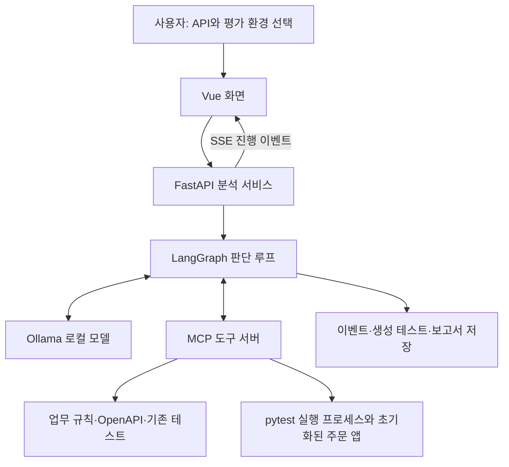

# 업무 규칙 기반 API 검증 누락 탐지 AI Agent 개발 진행 보고서

- 작성일: 2026년 10월 20일
- 프로젝트: `api_gap_agent`
- 개발 단계: 독립 실행 가능한 첫 프로토타입 구현 및 1차 실제 모델 평가 완료
- 사용 모델: 로컬 Ollama `qwen3:8b`

## 1. 개발 목적과 주제 선정

본 프로젝트는 업무 규칙, API 명세, 기존 테스트를 비교하여 누락된 검증 항목을 발견하고, 추가 조사와 테스트 생성·실행으로 판단 근거와 실제 동작을 확인하는 AI Agent를 만드는 것을 목적으로 한다.

초기에는 장애 대응 경험을 재사용하는 Agent와 API 검증 누락을 탐지하는 Agent를 비교했다. API 주제는 분석 범위를 제한하기 쉽고, 누락을 의도적으로 구성한 정답 데이터로 성과를 측정하기 좋다는 점에서 선택했다. 교수님의 의견을 반영하여 전체 API가 아닌 특정 서비스의 3~5개 API에서 권한·상태 전이·경계값 검증을 시작하기로 했다. 현재는 그중 3개 API를 구현했다.

다른 QA Agent 주제와의 차이는 출발점에 있다. 버그 리포트를 받아 재현·회귀 테스트를 만드는 방식과 달리, 본 프로젝트는 버그 보고가 없어도 업무 규칙을 기준으로 기존 테스트의 검증 공백을 조사한다.

## 2. 개발 범위

### 2.1 분석 대상

주문 서비스의 다음 API와 업무 규칙을 대상으로 한다.

| API | 규칙 ID | 업무 규칙 | 검증 관점 |
|---|---|---|---|
| `POST /orders` | ORDER-001 | 수량 1~100 허용, 0·101 거절, 네 경계값 검증 | 경계값 |
| `GET /orders/{order_id}` | ORDER-002 | 주문 소유자만 조회 가능, 타인 조회는 403 | 권한 |
| `POST /orders/{order_id}/cancel` | ORDER-003 | 배송 시작 후 취소는 409로 거절하고 shipping 상태 유지 | 상태 전이 |

평가를 위해 서비스 구현, 규칙 문서, 기존 테스트를 직접 준비했다. 현재는 사용자가 임의의 저장소를 업로드하는 범용 분석기가 아니라, 준비된 주문 서비스에 대한 프로토타입이다.

### 2.2 준비한 평가 환경

| 환경 | 기존 테스트 구성 | 서비스 구현 | 확인하려는 항목 |
|---|---|---|---|
| healthy | 경계값·배송 후 취소 검증 누락 | 정상 | 누락을 발견하고 새 테스트가 통과하는지 |
| buggy | healthy와 동일 | 배송 후 취소를 허용하는 의도적 결함 | 생성 테스트가 규칙 위반을 발견하는지 |
| covered | 세 규칙에 대한 기존 검증 존재 | 정상 | 이미 있는 검증을 중복 제안하는지 |

기존 테스트에는 별도 공통 파일의 타인 주문 조회 거절 검증이 포함되어 있다. 따라서 ORDER-002는 healthy 환경에서도 누락이 아니며, Agent가 여러 파일의 근거를 연결할 수 있는지 확인하는 사례가 된다.

## 3. 시스템 구조와 구현 내용

기존 실습의 FastAPI·LangGraph·MCP·Vue 구조를 참고하여, 기존 코드와 분리된 `api_gap_agent/` 폴더에 독립 실행 구조를 만들었다. 기존 프로젝트의 실행 파일은 수정하지 않았다.



| 구성 요소 | 구현 역할 |
|---|---|
| FastAPI | 분석 시작·조회, 화면 제공, 진행 이벤트 전송 |
| LangGraph | 다음 행동 선택, 도구 실행, 관찰 결과를 반영한 반복 판단 |
| Ollama | 로컬 모델 추론 및 JSON 구조화 출력 |
| MCP | 규칙·명세·테스트 조회와 후보 테스트 실행 도구 제공 |
| pytest / TestClient | 실제 API 처리 로직에 대한 테스트 실행 |
| Vue / daisyUI | 분석 범위 선택, 진행 과정, 규칙별 결과 표시 |
| JSON / JSONL | 실행별 보고서, 이벤트, 실제 응답 관찰 저장 |

### 주요 폴더

```text
api_gap_agent/
├── server.py                 # 분석 서비스와 SSE
├── mcp_server.py             # MCP 도구 서버
├── web_chat.html             # Vue 분석 화면
├── agent/                    # 모델 호출, 상태, 판단 루프, 출력 형식
├── tools/                    # 자료 조회와 후보 테스트 실행
├── sample_service/           # 주문 API와 분석 대상 기존 테스트
├── data/                     # 업무 규칙과 실행 환경 설명
├── evaluation/               # 정답 데이터와 성능 측정
├── tests/                    # Agent·도구·연동 회귀 검사
├── outputs/                  # 실행별 생성 코드·관찰·보고서
├── sh/                       # 실행 및 평가 스크립트
└── doc/                      # 범위·평가·실행 기록
```

## 4. 전체 동작 흐름

### 4.1 분석 요청

사용자가 주문 생성·조회·취소 중 분석할 API와 평가 환경을 선택한다. 자연어 분석 목표도 함께 전달할 수 있다.

### 4.2 자료 조사와 추가 조사

Agent는 현재까지 확보한 근거를 보고 다음 도구를 선택한다.

| 도구 | 역할 |
|---|---|
| `list_endpoints` | API 목록 확인 |
| `search_rules` | 업무 규칙 문서 조회 |
| `inspect_schema` | API 요청·응답 구조와 테스트 준비 조건 확인 |
| `search_tests` | 공통 파일을 포함한 기존 테스트 목록 조회 |
| `read_test_file` | 테스트의 실제 조건과 검증문 확인 |
| `run_candidate_test` | 구조화된 테스트 후보 검증·코드 생성·실행 |

현재 규칙 검색은 소규모 문서 전체를 반환하는 방식이다. 벡터 DB 기반 검색이나 대규모 문서 RAG는 아직 구현하지 않았다.

### 4.3 기존 검증 여부 판정

규칙, 선택한 API 명세, 기존 테스트 파일을 조사한 뒤 규칙별 상태를 기록한다.

- `missing`: 기존 검증 누락
- `covered`: 기존 검증 존재
- `uncertain`: 판단 보류

이 판정은 새 테스트를 실행하기 전에 저장한다. 생성한 테스트의 통과를 근거로 기존 누락을 없었던 것으로 바꾸지 않도록 분리했다. 다만 초기 판정 자체가 틀릴 수 있으며, 현재 이 문제는 남아 있다.

### 4.4 테스트 생성과 실제 실행

모델은 HTTP 메서드, 경로, 사용자, 요청 본문, 기대 상태 코드, 기대 JSON 값으로 테스트 후보를 작성한다. 실행 도구는 후보를 검증한 뒤 고정 Python 템플릿으로 변환하고, 별도 pytest 프로세스에서 실행한다.

모델이 작성한 임의의 Python 코드를 그대로 실행하는 방식은 아니다. 또한 각 테스트는 초기화된 별도 주문 앱을 사용한다. 이는 재현을 위한 실행 분리이며 운영 서비스 실행이나 OS 보안 샌드박스를 의미하지 않는다.

### 4.5 결과 관찰과 재판단

후보 형식 오류나 실행 결과를 Agent에게 돌려준다. Agent는 이를 보고 테스트를 수정하거나 결과를 보고한다. 이번 실제 실행에서는 배송 후 취소 후보가 검증 조건을 충족하지 못해 거절되었고, 모델이 수정한 후보는 실행에 성공했다.

최종 보고서는 다음을 구분한다.

| 항목 | 의미 |
|---|---|
| 기존 검증 여부 | 원래 테스트가 해당 업무 규칙을 검증하는가 |
| 후보 실행 결과 | 생성한 테스트가 통과·검증문 실패·실행 오류 중 무엇인가 |
| 구현 판정 | 실제 동작이 규칙을 준수·위반하는지, 또는 미확인인지 |

테스트 통과는 기존 검증의 존재를 뜻하지 않는다. 반대로 테스트 실패가 결함 탐지에 성공한 결과일 수 있으므로, 통과율만으로 Agent 성능을 평가하지 않는다.

## 5. Agent의 판단과 코드의 역할

전체 구조는 단계별 제약이 있는 자율 도구 선택 루프다. 코드가 모든 도구의 호출 순서를 고정하지는 않지만, 조사 완료와 테스트 실행에 필요한 선행 조건은 관리한다.

| 모델이 결정하는 부분 | 코드가 관리하는 부분 |
|---|---|
| 다음에 조회할 파일·명세와 조사 순서 | 현재 선택 가능한 도구와 입력 형식 |
| 기존 테스트가 규칙을 검증하는지 판단 | 판정 전 필요한 자료의 조회 여부 |
| 누락 후보의 요청과 기대값 제안 | 허용된 요청 및 후보 조건 검증 |
| 오류를 보고 후보 수정 | 도구 오류와 실제 응답 관찰 반환 |
| 최종 실행 결과 해석 | 기존 검증 판정 보존, 종료 조건 검사 |

반복 조회를 줄이기 위해 이미 읽은 파일과 명세는 다음 선택 대상에서 제외한다. 소규모 전체 자료를 반환한 검색도 성공 후 반복 선택에서 제외한다. 기본 판단 한도는 24회이며, 약 10분의 분석 예산과 모델 호출별 타임아웃을 둔다. 한도 도달 시 완료를 주장하지 않고 `incomplete`로 보고한다.

## 6. 개발 중 발견한 문제와 반영한 조치

| 발견한 문제 | 반영한 조치 | 현재 상태 |
|---|---|---|
| 같은 검색과 파일 조회 반복 | 미조회 자료 목록과 도구별 입력 제약 제공 | 반복을 줄이는 구조 반영 |
| 규칙에 없는 오류 응답 필드 생성 | 후보 검증 및 구체적인 오류 피드백 | 실행 전 거절·수정 가능 |
| 준비 정보 없이 테스트 실행 시도 | 자료 조사 및 기존 검증 판정을 선행 조건으로 설정 | 구조적 제약 반영 |
| 새 테스트 통과를 기존 검증으로 혼동 | 실행 전 기존 검증 판정을 저장하고 실행 해석과 분리 | 회귀 검사 및 실제 실행 확인 |
| 유효한 주문 2번 권한 테스트 거절 | 실행기의 허용 조건 수정 | 시스템 테스트 확인 |
| 공통 파일의 권한 검증을 놓침 | 평가 기준을 명시하고 근거 제공 구조 보완 | 최종 실제 평가에서도 오탐 발생 |

`qwen3.5:2b`도 시험했으나 여러 요청을 포함하는 후보를 불완전하게 작성하는 사례가 있어, 기본 모델은 `qwen3:8b`로 유지했다. 이 관찰은 제한된 개발 중 시험 결과이며 두 모델의 일반적인 우열을 의미하지 않는다.

## 7. 검증 결과

### 7.1 시스템 및 서비스 검사

개발 시점의 최종 검사에서 총 **17개 테스트가 통과**했다.

검사에는 MCP 실제 통신, 허용된 테스트 파일 접근, 생성 테스트 실행, 정상·결함 구현의 차이, HTTP 분석 요청과 SSE, 보고서 저장, 새 테스트가 기존 누락을 지우지 못하도록 하는 회귀 검사가 포함된다.

일부 연동 검사는 모의 모델을 사용하므로, 17개 통과가 실제 LLM의 탐지 정확도를 뜻하지는 않는다. 실제 모델 성능은 별도로 측정했다.

### 7.2 실제 모델 평가 조건

- 환경: healthy
- 모델: Ollama `qwen3:8b`
- 대상: API 3개, 업무 규칙 3개
- 실제 누락: ORDER-001, ORDER-003의 2개
- 기존 검증 존재: ORDER-002
- 실행 ID: `7469e6fcceab47e09a9b9be93e39bfba`
- 평가 단위: 규칙 단위

### 7.3 규칙별 결과

| 규칙 | 정답 | Agent 최종 판정 | 평가 |
|---|---|---|---|
| ORDER-001: 수량 경계값 | 누락 | 누락 | 올바른 탐지 |
| ORDER-002: 조회 권한 | 검증 존재 | 누락 | 오탐 |
| ORDER-003: 배송 후 취소 | 누락 | 누락 | 올바른 탐지 |

### 7.4 정량 결과

| 지표 | 결과 | 해석 |
|---|---:|---|
| 누락 탐지 정확도 | 66.7% | 누락 제안 3개 중 실제 누락 2개 |
| 누락 탐지 재현율 | 100% | 실제 누락 2개를 모두 발견 |
| 놓친 실제 누락 | 0개 | 이번 사례 기준 |
| 오탐 | 1개 | 공통 권한 테스트를 인식하지 못함 |
| 후보 실행 가능 비율 | 75% | 후보 시도 4회 중 3회 실행 완료 |
| 실행된 테스트 통과 | 3개 | 정상 구현에서 모두 통과 |
| 모델 판단 횟수 | 14회 | 도구 선택·평가·종료 포함 |
| 경과 시간 | 184.88초 | 약 3분 5초 |
| 누적 입력·출력 토큰 | 52,539개 | 여러 호출의 합계 |
| 분석 종료 상태 | completed | 설정된 절차를 완료 |

이 수치는 고정된 소규모 단일 사례의 결과이며, 다른 서비스나 전체 API에 대한 일반화 성능으로 해석할 수 없다. 후보 실행 가능 비율 역시 테스트의 의미가 항상 올바르다는 지표는 아니다.

### 7.5 결과 해석의 남은 한계

실행 가능한 후보 3개는 통과했지만, 실제 모델의 최종 `implementation` 필드는 세 규칙 모두 `unknown`으로 남았다. 즉, 테스트 실행과 관찰 기록은 완료했으나 모델이 그 결과를 구현 판정으로 충분히 연결하지 못한 한계가 있다.

또한 결함 구현에서 배송 취소 테스트가 실패하는 것은 시스템 검사에서 확인했지만, buggy·covered 환경에 대한 전체 실제 모델 평가는 아직 수행하지 않았다. healthy 환경에는 심어 둔 결함이 없으므로 이번 실행으로 실제 모델의 결함 탐지율을 평가할 수는 없다.

## 8. 완료 범위와 미완료 범위

| 구분 | 상태 |
|---|---|
| 독립 프로젝트 폴더와 실행 환경 | 구현 완료 |
| 주문 API 3개와 규칙·기존 테스트 자료 | 구현 완료 |
| MCP 조사 도구와 LangGraph 판단 루프 | 구현 완료 |
| 기존 검증 판정과 새 테스트 실행의 분리 | 구현 완료 |
| 구조화 후보의 코드 생성·실제 실행 | 구현 완료 |
| Vue 화면·SSE·실행 기록 저장 | 구현 완료 |
| 정답 기반 평가 코드와 healthy 실제 평가 | 완료 |
| 공통 테스트를 연결하는 정확한 의미 판단 | 개선 필요 |
| 실행 결과를 최종 구현 판정으로 연결 | 개선 필요 |
| buggy·covered 전체 실제 모델 평가 | 미수행 |
| 반복 평가와 고정 파이프라인 비교 | 미구현·미수행 |
| 임의 저장소·문서·API 분석 | 미구현 |
| 경험 메모리·대규모 문서 검색 | 미구현 |

현재 버전에는 규칙 ID와 후보 검증 조건 등 주문 서비스에 특화된 코드가 포함되어 있다. 범용 Agent로 확장하려면 이 부분을 규칙과 명세에서 추출한 일반적인 검증 구조로 바꿔야 한다.

## 9. 후속 개발 계획

| 우선순위 | 작업 | 확인할 개선 효과 |
|---|---|---|
| 1 | 기존 검증 평가 단계에 규칙과 원본 테스트 근거를 집중 제공 | 공통 테스트 누락 인식 오류 감소 |
| 2 | 실행 관찰과 최종 구현 판정의 연결 개선 | 통과·실패·환경 오류 해석의 명확성 |
| 3 | 세 평가 환경을 반복 실행 | 환경별 정확도·재현율·실패 패턴 확인 |
| 4 | 고정 조사 흐름과 같은 조건으로 비교 | 자율 도구 선택의 효과와 추가 비용 측정 |
| 5 | 후보 검증 조건의 일반화 | 규칙 추가 시 서비스별 하드코딩 감소 |
| 6 | 분석 대상과 문서 규모 확장 | 다른 API 및 문서 형식에 대한 적용 가능성 |

다음 단계는 API 개수를 늘리기보다 현재 3개 API에서 오탐과 결과 해석을 먼저 개선하는 것이 적절하다.

## 10. 실행 및 산출물 확인

```bash
cd api_gap_agent
bash sh/run.sh
```

화면 주소는 `http://127.0.0.1:8200`이다. Ollama와 지정한 로컬 모델이 준비되어 있어야 하며, 화면의 CDN 라이브러리를 불러오려면 인터넷 연결이 필요하다.

| 산출물 | 위치 |
|---|---|
| 실행 안내 | [README.md](../README.md) |
| 1차 범위 | [scope.md](scope.md) |
| 평가 방법 | [evaluation.md](evaluation.md) |
| 첫 실제 평가 기록 | [first_run.md](first_run.md) |
| 실제 모델 전체 보고서 | [report.json](../outputs/7469e6fcceab47e09a9b9be93e39bfba/report.json) |
| 실제 평가 지표 | [metrics.json](../outputs/7469e6fcceab47e09a9b9be93e39bfba/metrics.json) |
| 이벤트 기록 | [events.jsonl](../outputs/7469e6fcceab47e09a9b9be93e39bfba/events.jsonl) |

본 보고서는 코드와 저장된 실행 결과를 확인하여 작성했다. 보고서 작성 과정에서 실제 모델 평가를 추가로 실행하지는 않았다.
